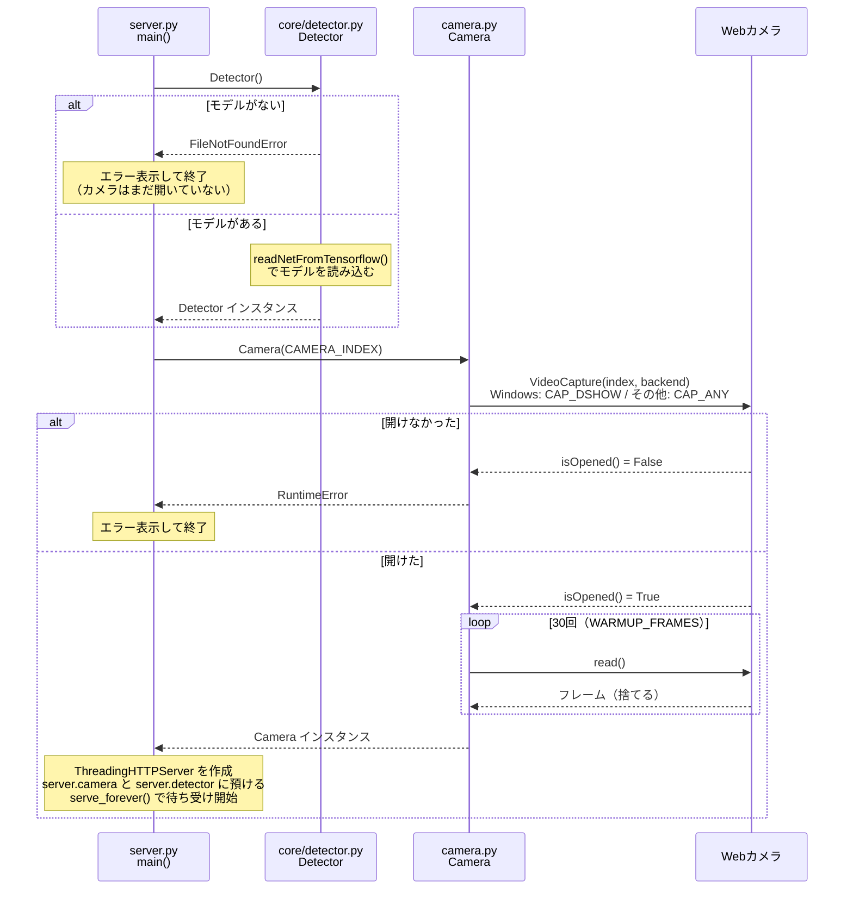
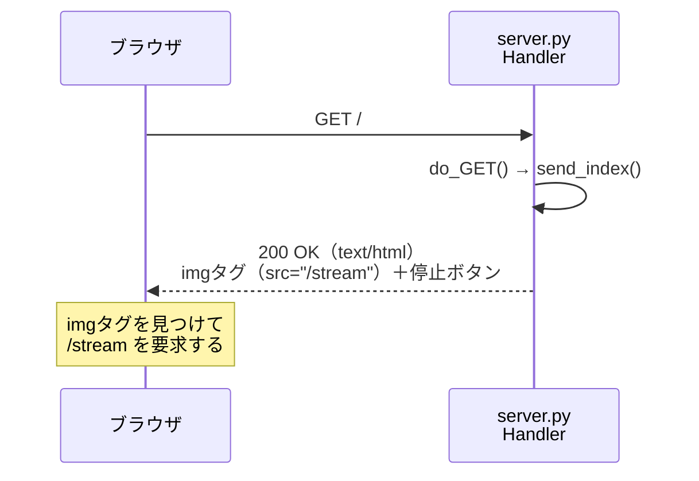
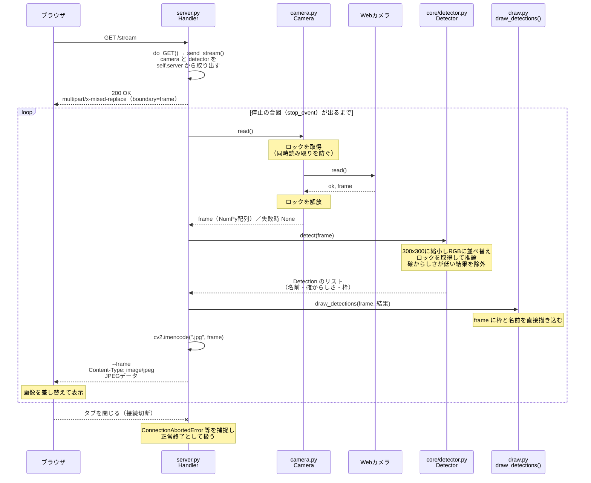
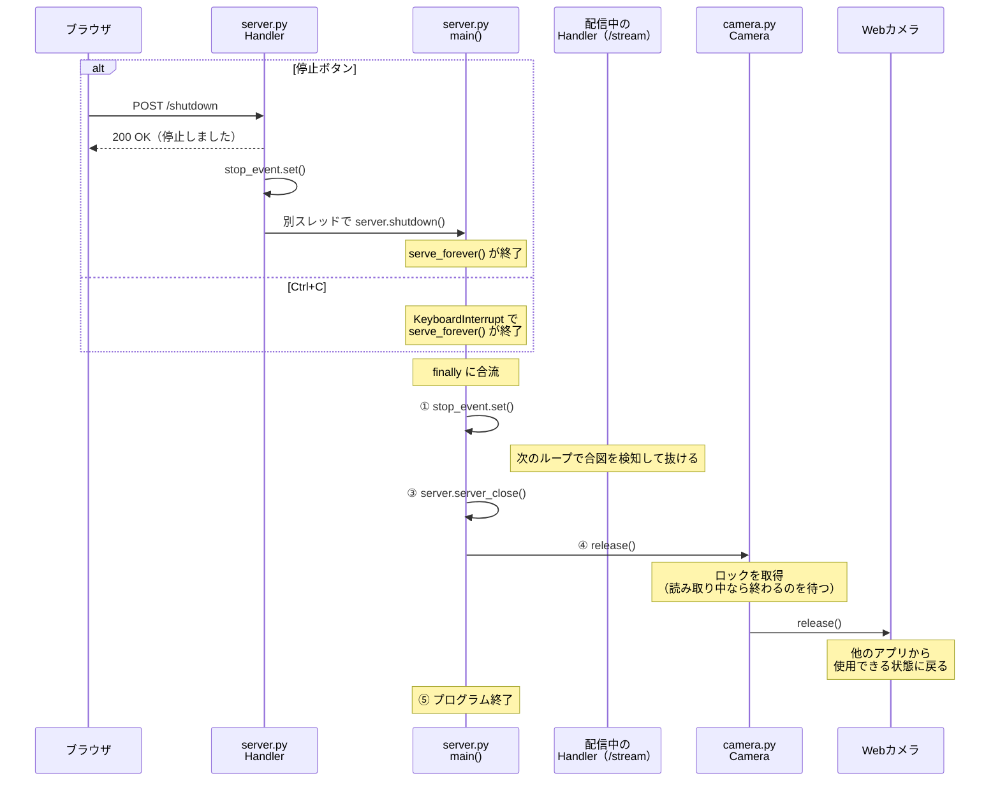

# local の仕組み

Windows上でUSB Webカメラの映像を取得し、物体判定の結果を重ねてブラウザへストリーミング配信する部品群です。

## ファイルの役割

| ファイル | 役割 | 知っていること | 知らないこと |
|---|---|---|---|
| `camera.py` | カメラ係。依頼されたら1フレームを渡す | カメラの開き方・読み方 | 判定、通信、ブラウザ |
| `draw.py` | 描画係。判定結果の枠と名前を画像に描く | 画像への描き込み | カメラ、判定の方法、通信 |
| `server.py` | 配信係。ブラウザの要求に応じて判定付きの映像を送る | HTTP、MJPEG、各係の呼び出し順 | カメラの開き方・判定の方法 |
| `detect_image.py` | 静止画1枚を判定するテスト用 | ファイルの読み書き | カメラ、通信 |
| `../core/detector.py` | 判定係（共通部品）。画像を受け取り結果を返す | モデルの読み込み・判定 | カメラ、描画、通信 |

役割を分けているのは、将来のAWS化でカメラ取得（→ブラウザ側）や通信（→API Gateway＋Lambda）を置き換えても、判定処理（`core/`）を共通で使えるようにするためです。
枠の描画も見せ方の処理なので `core/` ではなく `local/` に置いています（AWS版ではブラウザ側で描く想定）。

## 登場するもの

| 名前 | 説明 |
|---|---|
| ブラウザ | 映像を表示する利用者側 |
| `server.py` main() | 起動・終了の処理 |
| `server.py` Handler | リクエストごとに作られ、応答を返す |
| `camera.py` Camera | カメラ操作をまとめたクラス |
| `core/detector.py` Detector | 学習済みモデルで物体を判定するクラス |
| `draw.py` draw_detections() | 判定結果を画像に描き込む関数 |
| Webカメラ | OpenCV（`cv2.VideoCapture`）経由で読み取る実機 |

## ラダー図

### 1. 起動

モデルの読み込みをカメラより先に行います。モデルがなかった場合に、開いたカメラを解放し忘れないようにするためです。

### 2. ページの表示（GET /）

### 3. 映像の配信（GET /stream）

### 4. 終了（停止ボタン または Ctrl+C）

停止の入口は2つありますが、どちらも `serve_forever()` を抜けたあと `main()` の `finally` に合流し、同じ順番で停止します。

## 設計上のポイント

### ロックを Camera の中に持たせている理由
`ThreadingHTTPServer` はリクエストごとにスレッドを作るため、複数のタブで開くと同時にカメラを読みに来ます。ロックを `Camera` の中に閉じ込めることで、使う側（`server.py`）は同時アクセスを意識せずに `read()` を呼ぶだけで済みます。

### カメラをサーバーに預けている理由
`Handler` はリクエストのたびに `http.server` が自動で作るため、引数でカメラを渡せません。そこで `server.camera` に預け、`Handler` からは `self.server.camera` で取り出しています。

### ThreadingHTTPServer を使っている理由
`/stream` への応答は接続が切れるまで終わりません。1件ずつ処理する `HTTPServer` では、配信中に他のリクエストを受け付けられなくなるためです。

### 起動時にフレームを読み捨てている理由
カメラは起動直後、自動露出の調整が終わっておらず暗い画像を返すためです。

### 停止を「合図 → 受付停止 → 解放」の順にしている理由
配信中のスレッドがカメラを読んでいる最中に解放すると、予期せぬエラーにつながる可能性があります。先に停止の合図（`threading.Event`）を出して配信ループを止め、最後にカメラを解放します。

### release() にもロックをかけている理由
合図を出しても、配信スレッドがちょうど `read()` の途中である可能性があります。`read()` と `release()` で同じロックを使うことで、「読み取り中の解放」が起きないことを保証しています。解放後に `read()` が呼ばれた場合は `None` が返り、配信ループは静かに終了します。

### 停止ボタンを POST で受け付けている理由
GET にすると、ブラウザの先読みや URL を開いただけでサーバーが止まる事故が起こり得るためです。

### shutdown() を別スレッドで呼んでいる理由
`server.shutdown()` は `serve_forever()` が終わるまで待つ関数です。応答を返す処理を待たせないよう、別スレッドに任せています。

### 停止の入口を1つの出口に合流させている理由
停止ボタンと Ctrl+C で別々の終了処理を書くと、片方だけ修正漏れが起きやすくなります。どちらも `main()` の `finally` に合流させ、終了処理を1か所にまとめています。

### Detector にもロックを持たせている理由
OpenCV のモデル（`cv2.dnn.Net`）は、複数スレッドからの同時利用を想定していません。`setInput()`（入力のセット）と `forward()`（推論）の間に別スレッドが割り込むと、別の画像の結果を受け取る取り違えが起きるため、この2つをまとめてロックしています。画像の変換や結果の整理はスレッドごとに別のデータを扱うため、ロックの外に置き、待ち時間を最小限にしています。

### 判定を毎フレーム行っている理由
CPU での判定でも、実測で映像が気にならない程度の滑らかさを保てたためです。重くなった場合は、数フレームに1回だけ判定するなどの調整を検討します。

### Camera と Detector が終了せず例外を投げる理由
部品側でプログラムを終了させず、どう扱うか（エラー表示して終了など）は使う側に任せるためです。